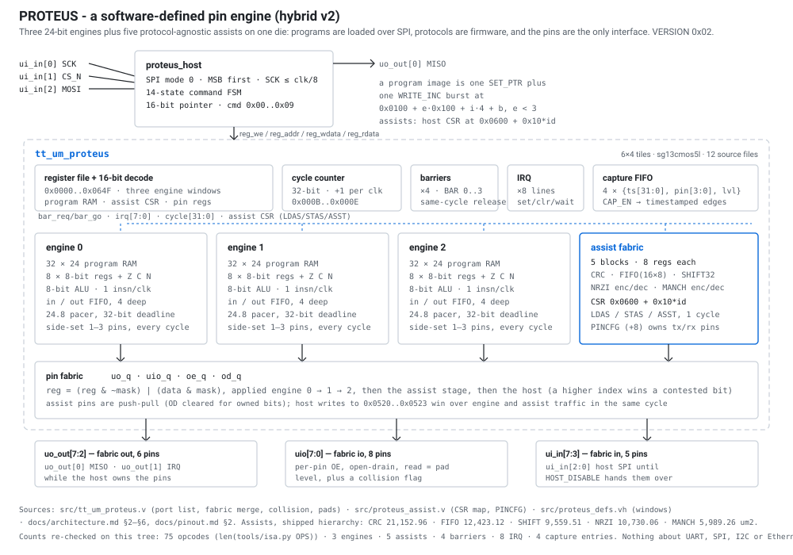
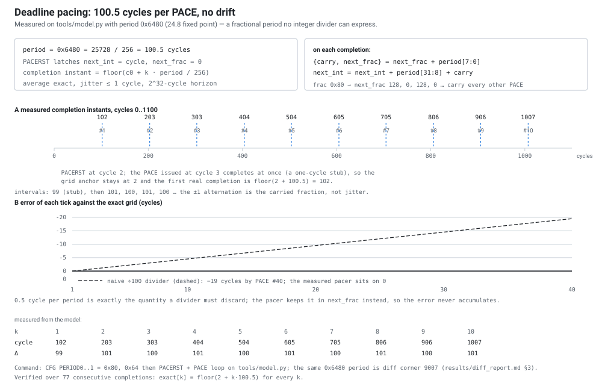
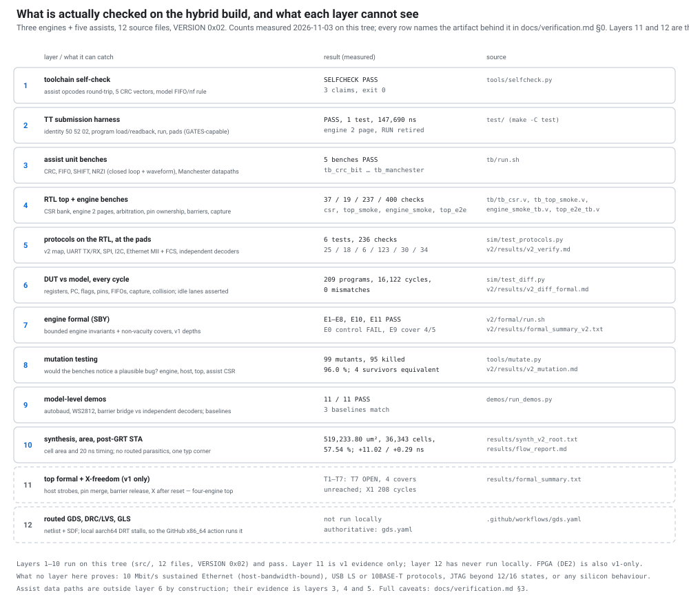

# PROTEUS - a programmable protocol engine

PROTEUS is a **software-defined pin engine** for the Jane Street protocol-emulator
ASIC competition: three independent 24-bit micro-engines plus **five
protocol-agnostic assists** on one die, sharing a 24-pin fabric with per-pin
direction and open-drain control, a 32-bit cycle timebase with deadline pacing,
hardware barriers, eight IRQ lines, and a 4-entry edge-timestamp capture FIFO.
Protocols are firmware; the silicon only supplies pins, time, data paths and
synchronisation. Target: Tiny Tapeout IHP `sg13cmos5l`, `6x4` tiles, 50 MHz,
submission deadline 2027-01-18 (`research/prior-art.md`).

Unlike a fixed UART/SPI/I2C block, the same three engines run UART, SPI and I2C
side by side from program memory that the host writes over SPI after reset -
and can be reprogrammed in the field, because nothing about a protocol is
committed to gates. The assists carry byte streams that would otherwise not fit
a 32-word engine: a bit-serial CRC, a 16 x 8 stream FIFO, a 32-bit shift
register, a USB low-speed NRZI pair and a Manchester pair, all behind three
instructions and one CSR window. The chip is also an *instrument*: the capture
unit timestamps edges to the cycle, so it observes a bus as well as driving one.

`VERSION` (`0x0002`) reads **`0x02`** for this hybrid build.

<p align="center">
  
</p>

Block diagram: `docs/figures/fig1_architecture.svg`. A three-minute tour with
runnable commands is in `docs/demo.md`; the other figures are under
`docs/figures/`.

---

## Architecture

```
                    host SPI (mode 0, MSB first, SCK <= clk/8)
   ui_in[0] SCK ───┐  ui_in[1] CS_N ─┐  ui_in[2] MOSI ─┐      uo_out[0] MISO
                   v                 v                 v              ^
              +--------------------------------------------------+     |
              |  proteus_host: 14-state command FSM, 16-bit ptr |-----+
              |  cmds 00..09: NOP WRITE_INC READ_INC SET_PTR_LO  |
              |  SET_PTR_HI WRITE_ADDR READ_ADDR PING RESET DIS  |
              +---------------------------+----------------------+
                                          | reg_we/reg_addr/reg_wdata
     +------------------------------------+-----------------------------------+
     |                          tt_um_proteus (top)                           |
     |  register file + decode | barriers(4) | IRQ(8) | capture FIFO (4)       |
     |  0x0000..0x064F         |             |        | 32-bit cycle counter    |
     +----+--------------+--------------+------+-----+--------+--------------+
          |              |              |      |              |
     +----v----+    +----v----+    +----v----+ +----v----------------------+
     | engine0 |    | engine1 |    | engine2 | | assist fabric (CSR 0x0600) |
     | 8 regs  |    |         |    |         | | CRC · FIFO · SHIFT         |
     | 8-bit ALU    |         |    |         | | NRZI enc/dec · MANCH enc/dec|
     | pacer   |    |         |    |         | | PINCFG ownership, 5 x 8 reg |
     +----+----+    +----+----+    +----+----+ +----+-----------------------+
          |  {data,mask} write buses per bank (uo / uio / oe / od)
          v              v              v            v
     +-----------------------------------------------------------------------+
     | pin fabric merge: engines 0..2, then assist stage, then host registers |
     | uo_q[7:0]  uio_q[7:0]  oe_q[7:0]  od_q[7:0]   od => high-Z release     |
     +-----------------------------------------------------------------------+
        |                    |                         |
   uo_out[7:2]          uio[7:0]                 ui_in[7:3]
   fabric out 6        fabric io 8, per-pin OE/OD   fabric in 5
       (+ uo_out[0]=MISO, uo_out[1]=IRQ while the host owns the pins)
```

### Three engines

| file | contents |
|---|---|
| `src/proteus_engine.v` | one engine: 32 x 24 program RAM, decode, 8-bit ALU, 4-deep in/out FIFOs, 24.8 pacer, side-set, barriers, IRQ, host register port, assist port |
| `src/tt_um_proteus.v` | pins, 3 engines, assist bank, merge (engines -> assists -> host), capture, barriers, IRQ, address decode |
| `src/proteus_host.v` | SPI slave, command FSM, 16-bit pointer |
| `src/proteus_defs.vh` | geometry, register map, opcode and CFG constants |

### Five protocol-agnostic assists

| id | block | function | area | CSR |
|---|---|---|---:|---|
| 0 | `crc_bit` | 5..32-bit CRC, runtime init/poly/xorout/reflection/bit order, 8 clocks per byte | 21,152.96 um2 | `0x0600..0x060F` |
| 1 | `assist_fifo` | 16 x 8 byte stream FIFO with drain port, burst counter and IRQ | 12,423.12 um2 | `0x0610..0x061F` |
| 2 | `shiftreg32` | 32-bit bidirectional shift register, byte push/pop, bit-stuff hook | 9,559.51 um2 | `0x0620..0x062F` |
| 3 | `nrzi_enc` + `nrzi_dec` | USB LS line code: stuffing, SYNC window, EOP/SE0, runtime bit clock | 10,730.06 um2 | `0x0630..0x063F` |
| 4 | `manchester_enc` + `manchester_dec` | 10BASE-T PCS at 20 Mbaud half-bits, 4x/8x oversampled receiver | 5,989.26 um2 | `0x0640..0x064F` |

Areas are the hierarchical per-module lines of the shipped synthesis
(`results/synth_v2_root.txt` lines 18834-19021). The set costs 59,854.90 um2
total; the fourth engine it replaced cost 132,381.80 um2 (study block,
`results/hybrid_area.md`). That
trade is why a complete 802.3 frame fits 31 words instead of the 230 words v1
measured (`results/ethernet.md`, `v2/results/v2_firmware.md`).

**Access model: three opcodes, not a memory window.**

| op | encoding | semantics |
|---|---|---|
| `LDAS` 0x4E | `rd` dest, `rs` assist register 0..7, `imm8[2:0]` assist id | `rd <- assist[id].reg[rs]`, combinational, 1 cycle; an empty source sets `nf` and leaves `rd` |
| `STAS` 0x4F | `rd` source, `rs` assist register, `imm8[2:0]` assist id | write; a write to `DATA` is the data-path side effect (fold a byte, push a byte) |
| `ASST` 0x50 | `rs` assist id, `imm8` command | reset/start/stop/arm/sync/eop/flush/latch, per-assist mapping |

Arbitration: the highest engine index wins a same-cycle write or command
collision (the pin-merge rule); a host CSR write wins over every engine. Reads
have one port per engine. `LDAS` is one instruction per byte, which is the
reason the assists exist: the engine's scarcest resource is instruction slots.

**CSR map.** Host view `0x0600 + 0x10*id + reg`, id 0..4, reg 0..7, window end
`0x064F`. Register 8 of each stride is the host-only `PINCFG`
(`[7] en, [6:5] bank, [4:2] tx_base, [1:0] rx_base`), so the engine view stays
exactly 8 registers. The per-assist register tables are in
`docs/programming.md` §2.6 and `src/proteus_assist.v`; `docs/isa.md` §6.1 is
the ISA-side summary.

**Pin ownership priority: host > assist > engine.**

```
engines 0..2 : reg = (reg & ~mask) | (data & mask)      engine 2 wins over 0
assist stage : reg = (reg & ~as_mask) | (as_data & as_mask), gated by PINCFG.en
               od  = od & ~as_od_mask                   assist pins are push-pull
host         : a write to 0x0520..0x0523 latches last   host wins that cycle
```

All five `PINCFG` registers reset to 0, so with no host configuration the assist
stage is the identity and the engines own the pads. Assist receive pins are
sampled from the raw pads, never from the merged output. The ownership
regression is `tb/top_e2e_tb.v` phase `[4e]`.

### Pacing, measured

The deadline pacer is the part that is hard to get right and easy to claim: a
100.5-cycle period (0x6480 in 24.8 fixed point) has no integer divider that can
express it. Measured on `tools/model.py`, the pacer's completions stay on
`floor(c0 + k*100.5)` while a naive divider loses half a cycle per period:

<p align="center">
  
</p>

The same mechanism turns into a real frame: `firmware/uart_tx.asm` (18 words)
produces the trace in `docs/figures/fig4_uart_frame.svg`, ten slots of exactly
434 cycles with transitions two cycles after each tick.

---

## ISA summary

24-bit instruction, one per cycle, **75 opcodes** (`len(tools/isa.py OPS)`), 8 x
8-bit registers, flags `Z`/`C`/`N`. Field layout (`tools/isa.py`,
`docs/isa.md` §1):

```
 23      17 16  14 13  11 10        3 2   0
+---------+------+------+------------+-----+
|   op    |  rd  |  rs  |    imm8    | ss  |
|  7 bits | 3 b  | 3 b  |   8 bits   | 3 b |
+---------+------+------+------------+-----+
```

| group | opcodes | examples |
|---|---|---|
| ALU immediate | `0x00..0x0E` | `LDI`, `ADDI`, `CMPI`, `SHLI`, `ADCI` |
| ALU register | `0x10..0x21` | `ADD`, `SUB`, `SHL`, `NOT`, `NEG`, `ADC` |
| Pin operations | `0x22..0x2D` | `SETP`, `CLRP`, `TOGP`, `OUTP`, `INPR`, `DIRS`, `DIRC`, `ODSET`, `OUTBIT`, `WAITP` |
| Control | `0x30..0x3E` | `JMP`, `JZ`, `DJNZ`, `HALT`, `WAITC`, `PACE`, `PACERST`, `ASSERT` |
| System / time | `0x40..0x4D` | `PUSH`, `PULL`, `IRQSET`, `IRQWAIT`, `BAR`, `TSLO`, `MEASLO`, `CAPTURE`, `CFG` |
| Assist access (v2) | `0x4E..0x50` | `LDAS`, `STAS`, `ASST` |

Representative encoding - `LDAS r1, r2, CRC` (read CRC register 2 into `r1`), as
produced by `tools/asm.py`:

```
word = 0x9c5000
  op   0x4E  = LDAS                     bits 23:17
  rd   1     destination register       bits 16:14
  rs   2     assist register index      bits 13:11
  imm  0     assist id 0 = CRC          bits 10:3
  ss   0     no side-set                bits  2:0
```

Field-level quirks worth knowing (all from `src/proteus_engine.v` /
`tools/asm.py`, not guesses):

- Pin ops: `rs[1:0]` = bank (`0`=UI, `1`=UO, `2`=UIO), `imm8` = mask; `OUTP`
  and `INPR` also carry a value register in `rd`.
- `WAITP bank, mask, level`: `rs = bank[1:0] | (level << 2)`, `imm8` = mask.
  So `WAITP UIO, 0x40, 1` assembles to `0x5A3201` with `[ss=1]`.
- `WAITC n` with `n = rs[2:0]:imm8` occupies `max(n,1)` cycles.
- Jump condition lives in `rd`; the assembler fills it from the mnemonic.

---

## Toolchain

Everything is plain Python 3.12 plus Icarus/Yosys; the virtualenv is `.venv`.

```sh
# assemble; --listing prints "engine address word  disassembly ; source line"
.venv/bin/python tools/asm.py firmware/uart_tx.asm --listing
.venv/bin/python tools/asm.py firmware/i2c_master.asm --depth 32 -o i2c.json

# cycle-accurate golden model (executable specification)
.venv/bin/python -c "import sys; sys.path.insert(0,'tools'); import model; print(model.ProteusModel)"

# toolchain self-check: assist opcode round-trip, five CRC vectors, model FIFO/nf
python3 tools/selfcheck.py

# assembler/model mutation catalogue used by the mutation score
python3 tools/mutate.py --list
```

Instruction counts at the default depth 32 (`tools/asm.py`, measured):

| firmware | words | engines |
|---|---:|---|
| `firmware/pin_blink.asm` | 5 | 0 |
| `firmware/uart_tx.asm` | 18 | 0 |
| `firmware/uart_rx.asm` | 26 | 1 |
| `firmware/spi_master.asm` | 32 | 2 (exactly full) |
| `firmware/i2c_master.asm` | 32 + 32 | 2 + 1 |
| `firmware/ethernet_mii_tx.asm` | 31 | 0 + CRC/FIFO assists |

---

## Verification

Current state, measured 2026-11-03 on this host. Commands are copy-pasteable;
the report behind every row is in `docs/verification.md` §0.

| suite | command | result |
|---|---|---|
| Toolchain self-check | `python3 tools/selfcheck.py` | **SELFCHECK PASS** (assist opcodes round-trip, 5 CRC vectors, model FIFO/`nf`) |
| Official TT submission gate | `PATH=$PWD/.venv/bin:$PATH make -C test` | **PASS**: 1 test, 147,690 ns, `VERSION 0x02`, 13-word program over SPI, engine 2 page, `RUN` retired by `HALT` |
| **Protocols on the real RTL** | `cd sim && make` | **PASS 6/6, 236 checks**: v2 map 25, UART TX 18, UART RX 6, SPI 123, I2C 30, **Ethernet MII TX 34** (`v2/results/v2_verify.md`) |
| RTL directed benches | `bash tb/run.sh` | **PASS=10 FAIL=0**; `tb_csr` 37, `tb_top_smoke` 19, `engine_smoke` 237, `top_e2e` 400 checks |
| **DUT vs golden model, cycle lockstep** | `cd sim && make diff` | **PASS**: 209 programs, **16,122 compared cycles, 0 mismatches**, no program cut at the cap (`v2/results/v2_diff_formal.md`) |
| Engine formal (SBY) | `./v2/formal/run.sh` | **E1-E8, E10, E11 PASS** at v1 depths, E0 expected-fail control, E9 cover 4/5 (`v2/results/formal_summary_v2.txt`) |
| Mutation testing | `python3 tools/mutate.py --all` | **99 mutants, 95 killed = 96.0 %**; 4 survivors shown equivalent (`v2/results/v2_mutation.md`) |
| Model-level demos | `python3 demos/run_demos.py` | **11/11 PASS**, 3 baselines match (`docs/verification.md` §2.6) |
| Synthesis / area | `scripts/synth_full.sh` | **519,233.80 um2 flat, 36,343 cells, 57.54 % of row area** (hierarchical 538,016.13 = 59.62 %); `results/synth_v2_root.txt` lines 47230 / 47202 / 19254 |
| Post-GRT STA | `results/flow_report.md` | setup **+11.0205 ns**, hold **+0.2878 ns** on 20 ns (typ, before routed parasitics) |
| GDS / DRC / LVS / GLS | GitHub `gds.yaml` (x86_64) | **not run yet**; local aarch64 DRT stalls, see `results/flow_report.md` |

<p align="center">
  
</p>

A layered view of the evidence, with the artifact behind every count, is in
`docs/figures/fig6_verification.svg` (its row order is independent of the layer
numbers in `docs/verification.md` §1). Counts are a snapshot: re-run the command
in the row above and the figure's source column to refresh them.

The strongest single result is the differential: every architectural register,
pin, FIFO content and capture event is compared on every cycle, and an injected
`INC` fault was caught on the first compared cycle. The protocol row is the one
that exercises the real pads for UART, SPI, I2C and a complete Ethernet frame.

**Known gaps, stated rather than implied** (`docs/verification.md` §3): no routed
GDS, DRC/LVS, antenna check or slow-corner timing (local aarch64 OpenROAD
detailed routing stalls; the GitHub x86_64 `gds.yaml` action is authoritative);
no gate-level simulation; top-level formal T1-T7 and the FPGA build are v1-only,
and **T7 is open**; assist data paths are outside the differential; Ethernet is
host-bandwidth-bound at a 16-byte FIFO (content and pad protocol proven, 10 Mbit/s
sustained not); JTAG is a partial v1 experiment; USB LS and 10BASE-T have
assists but no protocol demo; the v2 tree ships no pytest suite (v1's 179 tests
are at `legacy/v1/tools/tests/`).

---

## Synthesis and physical flow

```sh
make pdk            # IHP-Open-PDK @2bbec755 into $HOME/pdk
make pdk-lite       # liberty-only alternative
scripts/synth_full.sh   # hierarchical + flat; default OUT=results/synth_full.txt
                        # sign-off log is results/synth_v2_root.txt; the older
                        # v2/results/synth_v2.txt is superseded (docs/verification.md §2.9)
make flow           # LibreLane 6x4 hardening (Docker) -> runs/wokwi/final
```

**Area is measured** on the 12-file hybrid tree (`results/synth_v2_root.txt`;
per-module lines 18723-19021, arithmetic in `results/final_evidence.md` §3):

| quantity | value |
|---|---:|
| full-chip, flat / sign-off | **519,233.80 um^2**, 36,343 cells |
| full-chip, hierarchical sum | 538,016.13 um^2 (59.62 % of rows) |
| utilisation | 57.54 % of 902,417 um^2 row area |
| vs 60 % placement budget (541,450.20 um^2) | 95.90 %, 22,216.40 um^2 spare |
| engines (hierarchical, per module) | 132,741.24 / 132,576.77 / 131,313.72 um^2 |
| assist set (7 blocks, hierarchical) | 59,854.90 um^2 |
| `proteus_host` (hierarchical) | 12,707.07 um^2 |
| `proteus_assist` wrapper + CSR (own cells; the assists are counted above) | 31,715.86 um^2 |
| `tt_um_proteus` top glue (own cells) | 37,106.56 um^2 |

The last five lines add up to the hierarchical total: 396,631.73 (engines) +
59,854.90 (assists) + 31,715.86 + 12,707.07 + 37,106.56 = 538,016.13 um^2.

The assist set costs less than the engine it replaced (59,854.90 um^2 for all
seven assist blocks against 132,741.24 um^2 for one engine), and the flat result
sits inside the 60 % placement budget with **22,216.40 um^2 spare** (4.1 % of
the budget); the hierarchical sum is inside by 3,434.07 um^2. That is the first
build in this project inside the budget on both counts. It is **12,350.58 um^2
(+1.37 pp) above** the study prediction of 506,883.22 um^2, not below it, and
that overshoot is not fully attributed (`docs/verification.md` §2.9). Timing at
50 MHz has a post-global-route number
(**+11.0205 ns setup / +0.2878 ns hold** at 20 ns, `results/flow_report.md`), but
routing is not signed off: six local LibreLane attempts stalled in OpenROAD
detailed routing with an identical silent signature at both placement targets
tried (65 % on v1, 60 % on this tree - the `PL_TARGET_DENSITY_PCT` knob, distinct
from the 57.54 % measured cell area), while the 1x1 smoke flow completes. That is
an aarch64 runtime block, not a density verdict; the authoritative gate is
`.github/workflows/gds.yaml` on x86_64.

---

## Repository layout

```
info.yaml               Tiny Tapeout project metadata (tiles 6x4, 50 MHz, 12 sources)
src/                    RTL: defs header, engine, host SPI, top, 5 assists (12 files)
docs/architecture.md    implementation contract (behaviour, register map, merges)
docs/isa.md             ISA prose mirror of tools/isa.py (75 opcodes)
docs/info.md            Tiny Tapeout project page
docs/verification.md    methodology, commands, current evidence, gaps
docs/demo.md            three-minute demo script + figure provenance
docs/hybrid-architecture.md  the measured 3-engine + assists study and its risks
docs/flow.md            LibreLane / PDK commands and measured runtimes
docs/figures/           SVG figures (architecture, fabric, pacer, traces, ladder)
docs/pinout.md          physical pins, bank map, host reservation, assist ownership
docs/programming.md     programmer guide: frames, registers, assist CSR, assembler
docs/ai-development.md  auditable account of the autonomous build
research/               protocol timing, IHP constraints, prior art, ISA survey
tools/isa.py            opcode + encoding source of truth
tools/asm.py            assembler (labels, equates, side-set, assist operands)
tools/model.py          cycle-accurate golden model (executable spec)
tools/diffgen.py        differential corpus generator
tools/mutate.py         99-mutation catalogue and runner
tools/selfcheck.py      toolchain self-check (opcodes, CRC vectors, FIFO/nf)
firmware/               6 assembly programs (UART TX/RX, SPI, I2C, Ethernet, blink)
demos/                  autobaud, WS2812, barrier-synced UART-SPI bridge + runner
tb/                     10 Icarus benches: 6 assist units, csr, top smoke, engine, top e2e
test/                   official Tiny Tapeout cocotb gate (tb.v, Makefile, test.py)
sim/                    cocotb harness: map, protocols, differential
v2/formal/              SBY engine harness for the v2 port list
v2/results/             v2 evidence: verify, diff+formal, mutation, synthesis, firmware
results/                measured evidence; flow_report.md, area, v1 records
scripts/                synth.sh, synth_full.sh, flow.sh, fetch_pdk.sh
legacy/v1/              the previous four-engine build (frozen, do not modify)
fpga/                   DE2 project for the v1 top only (not ported to v2)
```

---

## Reproduction

```sh
git clone <repo> && cd proteus
python3 -m venv .venv && .venv/bin/pip install pytest cocotb pyyaml

# 1. toolchain + logic
python3 tools/selfcheck.py

# 2. official submission gate (pads only)
PATH=$PWD/.venv/bin:$PATH make -C test

# 3. protocols on the RTL, then DUT vs model every cycle
cd sim && make && make diff && cd ..

# 4. directed RTL benches + model-level demos
bash tb/run.sh
python3 demos/run_demos.py

# 5. engine formal
./v2/formal/run.sh

# 6. area (needs the IHP liberty)
make pdk-lite && scripts/synth_full.sh

# 7. GDS + slow-corner timing: push and let .github/workflows/gds.yaml run
```

Every number above is either quoted from the cited file or was produced by the
command in the same row. Where a number does not exist, the command that
produces it is given instead.

---

## v1 (previous build)

The previous four-engine design is preserved unchanged at `legacy/v1/`
(`legacy/v1/src`, `legacy/v1/README.md`, `legacy/v1/SUBMISSION.md`) and was the
first full submission: 4 engines x 32 x 24 program RAM, 72 opcodes,
`VERSION 0x01`, **581,138.67 um2 hierarchical / 558,240.45 um2 flat, 42,049
cells = 64.4 % of row area** (`results/area_full.md`), 107.3 % of the 60 %
placement budget. It owns the evidence that v2 does not have: the top-level
formal suite T1-T7 with X1 (`results/formal_summary.txt`), the DE2 FPGA demos
(36 checks, 0 errors, v1 tree), the v1 differential (`results/diff_report.md`),
the v1 protocol run (`results/protocol_rtl.md`) and the v1 mutation score
(`results/mutation.md`). It did not route at 64.4 % on this host
(`results/flow_report.md`). v2 replaces it because the fourth engine cost more
than the entire assist set and Ethernet needed the assists, not another lane.

---

Apache-2.0 (`LICENSE`).
