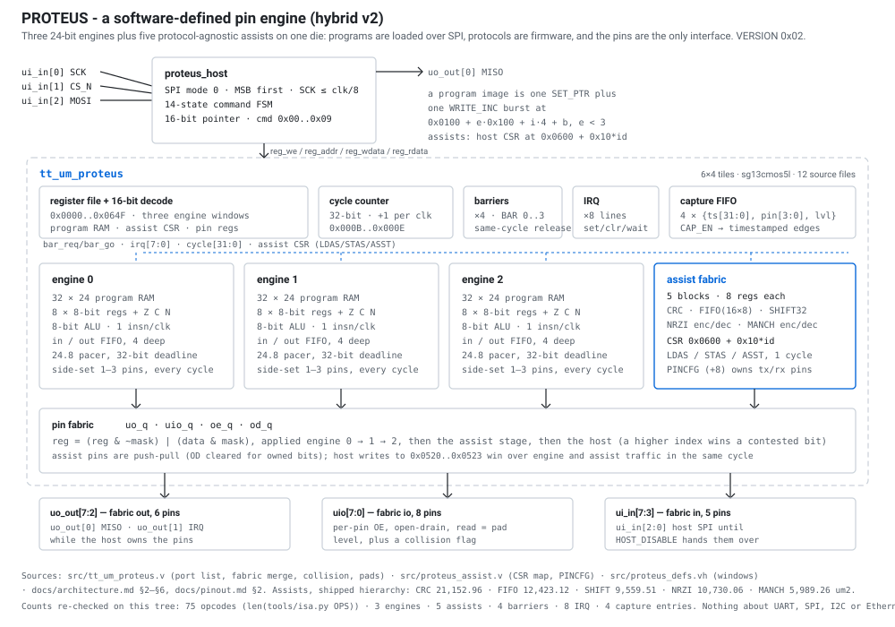
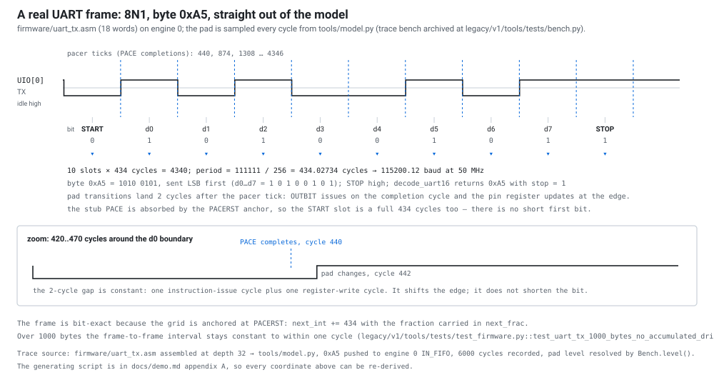
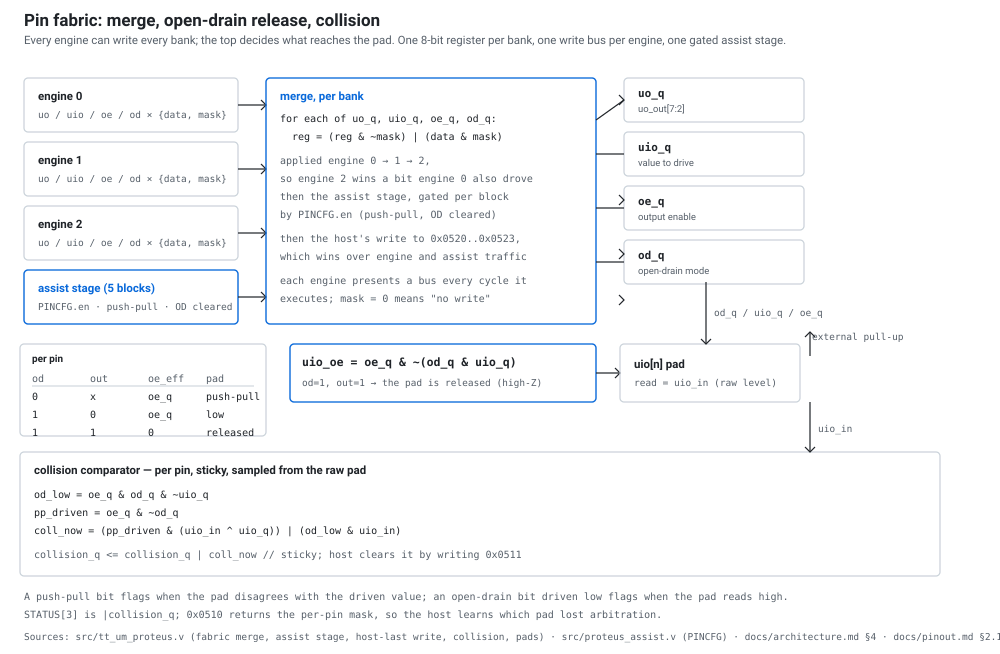

# PROTEUS - programmable protocol engine

PROTEUS is a general-purpose **protocol emulator** on a Tiny Tapeout IHP
`sg13cmos5l` die: **three** 24-bit micro-engines, each with its own
32-instruction program RAM, 8 x 8-bit registers and flags, a 4-deep input and
output FIFO, a deadline pacer and side-set pin hardware, plus **five
protocol-agnostic assists** (CRC, 16 x 8 byte FIFO, 32-bit shift register, NRZI
encoder/decoder, Manchester encoder/decoder) behind a single CSR interface. They
share a 24-pin fabric in which every pin has independent direction, open-drain
and readback control, a 32-bit cycle timebase, four hardware barriers, eight IRQ
lines and a 4-entry edge-timestamp capture FIFO. The engines execute one
instruction per clock from program memory that the host writes over SPI after
reset, so UART, SPI, I2C and Ethernet MII are firmware images, not fixed blocks -
and the same silicon can be reprogrammed for a protocol nobody wrote gate logic
for. `VERSION` reads **0x02** for this hybrid build.

The chip is deliberately an *instrument* as well as an emulator. The capture
unit timestamps edges on the bidirectional pins to the cycle, the pacer hits
non-integer period ratios without accumulated drift (416.6667 cycles per bit is
a legal period), and the open-drain plus collision logic makes real I2C
arbitration possible rather than a firmware approximation. Between capture,
barriers and the per-engine FIFOs, the engines that generate a bus can also
observe it and hand decoded bytes to the host or to another engine.

<p align="center">
  
</p>

---

## Why this is not a fixed UART / SPI / I2C block

| | fixed protocol block | PROTEUS |
|---|---|---|
| behaviour | gates | 24-bit program in RAM, written over SPI |
| adding a protocol | respin | assemble and load it |
| timing | counters per protocol | one 24.8 deadline pacer per engine, no drift |
| pins | dedicated per function | 24-pin fabric, per-pin direction / open-drain / readback |
| observing a bus | not possible | 4-entry timestamped capture FIFO plus per-engine timestamps |
| cooperating blocks | - | 4 barriers, 8 IRQ lines, FIFOs between host and engines |
| byte streams | dedicated MAC/PHY | CRC + FIFO + shift + line-code assists, 1 instruction per byte |

Three engines instead of four is a measured trade: the fourth engine cost
132.4k um2 (study block, `results/hybrid_area.md`) while the whole five-block
assist set measures 59,854.90 um2 in the shipped hierarchy
(`results/synth_v2_root.txt`), and assists are what make a complete 802.3 frame
fit a 32-word program. The study, the engine-count table and the risks are
`docs/hybrid-architecture.md`; the shipped number is **519,233.80 um2 flat,
36,343 cells = 57.54 % of the 902,417 um2 row area**, 95.90 % of the 60 %
placement budget with 22,216.40 um2 spare (hierarchical 538,016.13 um2 = 59.62 %).
That is 12,350.58 um2 (+1.37 pp) **above** the study prediction of
506,883.22 um2. The previous four-engine build is archived at `legacy/v1/`
(581,138.67 um2, 64.4 %).

## Pinout

The pinout is **unchanged from v1**: no pad moved.

| pin | name | direction | function |
|---|---|---|---|
| `ui_in[0]` | `HCLK` | in | host SPI clock (mode 0). Max `clk/8` |
| `ui_in[1]` | `HCS_N` | in | host SPI chip select, active low, frames one command |
| `ui_in[2]` | `MOSI` | in | host SPI data in, MSB first |
| `ui_in[7:3]` | fabric in | in | 5 general-purpose inputs, bank `UI` |
| `uo_out[0]` | `MISO` | out | host SPI data out while the host owns the pins |
| `uo_out[1]` | `IRQ` | out | `&#124;(irq &amp; irq_enable)` while the host owns the pins |
| `uo_out[7:2]` | fabric out | out | 6 general-purpose outputs, bank `UO` |
| `uio[7:0]` | fabric io | inout | 8 bidirectional pins, bank `UIO`, per-pin OE and open-drain |

Host pins stay reserved until the host issues `HOST_DISABLE` (command `0x09`);
after that `ui_in[2:0]` and `uo_out[1:0]` belong to the fabric, giving **24**
fabric-usable pins (19 while the host is active). `uio_out` drives the pad,
`uio_oe` is the output enable, and `uio_in` is the raw pad level. Assists own
pins only through their host-only `PINCFG` register, and their pins enter the
merge above the engines and below the host (`docs/pinout.md` §2).

## How it works

**Three engines.** Each engine executes a 24-bit instruction per cycle from its
own 32-word program RAM. The word is
`op[23:17] rd[16:14] rs[13:11] imm[10:3] ss[2:0]`; there are **75 opcodes**: an
8-bit ALU with immediate and register forms, per-instruction pin masks,
branches, `WAITC`, `PACE`, FIFO push/pull (blocking and non-blocking), IRQ
set/clear/wait, `BAR`, timestamp and capture instructions, `CFG`, and the three
assist instructions `LDAS`/`STAS`/`ASST`. Most instructions retire in one cycle;
`WAITC`, `WAITP`, `PACE`, `IRQWAIT`, `BAR` and a blocked `PUSH`/`PULL` hold the
program counter and re-execute until their condition is met. A `HALT` clears the
engine's run bit and freezes its PC.

**Five assists.** `LDAS rd, rs, ASSIST` reads, `STAS rd, rs, ASSIST` writes and
`ASST ASSIST, CMD` commands one of eight registers on one of five blocks. Reads
are combinational, so a transfer is one instruction, one cycle; an empty source
sets `nf` and leaves `rd` unchanged (the `PULLN` rule). The host sees the same
registers at `0x0600 + 0x10*id + reg`, so it can configure polynomials, bit rates
and pin ownership once without spending engine instructions.

| id | assist | what it does | area |
|---|---|---|---|
| 0 | CRC | 5..32-bit CRC, runtime init/poly/xorout/reflection, 8 clocks/byte | 21,152.96 um2 |
| 1 | FIFO | 16 x 8 byte stream buffer, drain port, burst counter + IRQ | 12,423.12 um2 |
| 2 | SHIFT | 32-bit bidirectional shift register, byte push/pop, stuff hook | 9,559.51 um2 |
| 3 | NRZI | USB LS encoder/decoder: stuffing, SYNC, EOP/SE0, runtime bit clock | 10,730.06 um2 |
| 4 | MANCH | 10BASE-T PCS encoder + 4x/8x oversampled receiver | 5,989.26 um2 |

Areas are the hierarchical per-module lines of the shipped synthesis
(`results/synth_v2_root.txt`), 59,854.90 um2 for the set; the packed
set is why a complete 802.3 frame fits `firmware/ethernet_mii_tx.asm` in 31
words instead of the 230 words v1 measured (`results/ethernet.md`).

**Pin fabric.** Per engine, per bank, the engine drives `{data, mask}`. The top
merges engines 0..2 in order with `reg = (reg & ~mask) | (data & mask)`, so a
higher-numbered engine wins a contested bit in the same cycle, then applies one
assist stage per bank (assist pins are push-pull, so it also clears open-drain
for the bits it owns), then the host's pin-register write, which wins over
everything in that cycle. Any write to the `UIO` bank also sets that pin's
output enable (auto-direction); `DIRS`/`DIRC` change direction without that side
effect. Side-set drives 1..3 contiguous pins on *every* cycle the instruction is
in flight, including stall cycles - that is how an I2C master holds SCL high
across a `WAITP` without extra instructions.

**Pacer.** `period` is 24.8 unsigned fixed point. `PACERST` arms the deadline at
the current cycle; each `PACE` stalls until `cycle >= next_int`, then advances
`next_int` by `period[31:8]` plus the carry out of `next_frac + period[7:0]`.
Completion instants are exactly `floor(c0 + k*period/256)`: the average rate is
exact, jitter is at most one cycle, and there is no accumulated drift - the
2^24 boundary does not truncate because the integer part is a full 32 bits.
Measured on the tree:

```
pacer probe @cycle 2^24: 100 completions in 9802 cycles (period=100) -> 98.0 cycles/completion: exact
```

<p align="center">
  
</p>

The trace above is the mechanism at work: `firmware/uart_tx.asm` (18 words)
generates byte `0xA5` with every one of the ten slots exactly 434 cycles wide
(`111111/256` = 434.02734 cycles = 115200.12 baud at 50 MHz), and the pad
transition lands two cycles after the pacer tick, every time. The same image on
the RTL measures frame-start deltas of 4343 cycles against an ideal 4340.27
(`sim/test_protocols.py`).

**Capture.** `CAP_EN` selects watched `uio` pins. Every edge on a watched pin
pushes `{cycle[31:0], pin[3:0], level}` into a 4-entry FIFO and sets a sticky
overflow flag; at most one event is pushed per cycle and the lowest changed pin
wins. Any engine can also push a software event with `CAPTURE tag`. The host
reads a snapshot of the head entry (`CAP_TS0..3`, `CAP_INFO`) and writes
`CAP_POP` to advance, so a slow host cannot lose the timestamp it is reading.

**Barriers.** `BAR id` (0..3) completes when every engine whose run bit is set
has arrived at the same barrier; the barrier then clears in the arrival cycle.
On the RTL bench, two engines that arrive after a different number of
instructions still leave in the same cycle (`uio0=62156 uio1=62156`,
`v2/results/v2_mutation.md` §2.2).

**Open drain.** With a pin's `od` bit set, writing `1` releases the pad (high-Z,
external pull-up) and writing `0` drives it low; effective drive is
`oe & ~(od & out)`. Collision detection is sticky and per-pin: a push-pull
driven bit whose pad disagrees with the driven value, or an open-drain
driven-low bit whose pad reads high, sets the corresponding bit of `0x0510`
until the host clears it with `0x0511`.

<p align="center">
  
</p>

---

## How to program it

The host talks SPI mode 0, MSB first, at `SCK <= clk/8`. `CS_N` frames one
command; the command byte is followed by its payload.

| cmd | name | payload |
|---|---|---|
| `0x00` | NOP | - |
| `0x01` | WRITE_INC | data bytes -> `PTR`, `PTR++` |
| `0x02` | READ_INC | read bytes <- `PTR`, `PTR++` |
| `0x03` | SET_PTR_LO | 1 byte -> `PTR[7:0]` |
| `0x04` | SET_PTR_HI | 1 byte -> `PTR[15:8]` |
| `0x05` | WRITE_ADDR | 2 bytes LE address, then data bytes (auto-increment) |
| `0x06` | READ_ADDR | 2 bytes LE address, then read bytes (auto-increment) |
| `0x07` | PING | reads `0x50` |
| `0x08` | SOFT_RESET | resets the chip |
| `0x09` | HOST_DISABLE | releases the host pins until reset |

For read commands the chip shifts out the byte for the current address while the
host clocks dummy bytes. The 16-bit pointer means a program image is one
`SET_PTR` plus one `WRITE_INC` burst.

Program memory is byte-addressed at `0x0100 + e*0x100 + i*4 + b` for engine
`e < 3`, instruction `i < PROG_DEPTH`, byte `b < 3` (little endian: byte `b` is
bits `8b+7:8b` of the 24-bit word). The window ends at `0x03FF`; `0x0400` is the
v1 engine-3 page and reads 0. Writes with `i >= PROG_DEPTH` are dropped and read
back as `0`; byte lane 3 is not used. The default build has `PROG_DEPTH = 32`,
i.e. 96 usable bytes per engine at `0x0100`, `0x0200`, `0x0300`.

Engine state is memory-mapped at `0x0010 + 0x20*e` for `e = 0..2` (status, PC,
error, r0..r7, period bytes, FIFO ports, bit-pin/side-set/timeout config, window
ends `0x006F`); global control is `0x0000..0x000E` (`VERSION` = `0x02`); capture,
collision and direct pin registers are at `0x0500..0x0530`; the assist CSR bank
is `0x0600 + 0x10*id + reg` for id 0..4, ending `0x064F`, with `PINCFG` at `+8`.
The complete map is `docs/programming.md` §2 and `docs/architecture.md` §6.

Assist CSR summary (one register window per assist; full tables in
`docs/programming.md` §2.6):

| id | reg 0 | reg 1 | reg 2 | reg 3 | reg 4..7 |
|---|---|---|---|---|---|
| 0 CRC | DATA (fold byte) | STATUS busy/drop/empty | CFG0 width/refl/lsb | CMD (page/start/flush) | result or init/poly/xorout page |
| 1 FIFO | DATA (push/pop) | STATUS level/full/empty | BURSTLEN | CMD (arm/clear) | POPS, IRQ |
| 2 SHIFT | DATA | STATUS | CFG width/dir/en | CMD | dout lanes |
| 3 NRZI | TXDATA | RXDATA | STATUS | DIV clocks/bit | - |
| 4 MANCH | TXDATA | RXDATA | STATUS | CFG (fixed HALF_DIV/OS) | - |

## Tested demos

Evidence column names the artifact that actually contains the passing check.
"model" means the cycle-accurate reference model in `tools/model.py` driven
through independent protocol decoders - not the RTL. RTL-level evidence is
called out separately.

| demo | engines / pins | words | status | evidence |
|---|---|---|---:|---|
| UART TX 8N1, 115200 at 50 MHz | eng0, `UIO[0]` via `BITPIN` | 18 | **passing in model and on the RTL** | `firmware/uart_tx.asm`; RTL pads: `sim/test_protocols.py::proteus_uart_tx_pins` (18 checks, 434.03 cycles/bit); model: `demos/run_demos.py` |
| UART RX 8N1, half-bit pacer sampling | eng1, `UIO[1]` | 26 | **passing in model and on the RTL** | `firmware/uart_rx.asm`; RTL pads: `proteus_uart_rx_pins` (6 checks, 9 bytes incl. framing error); model: `demos/run_demos.py` |
| SPI master, mode 0, 8-bit MSB first | eng2, `UIO[2]` SCK side-set, `UIO[3]` MOSI, `UIO[4]` MISO, `UIO[5]` CS_N | 32 | **passing in model and on the RTL** | `firmware/spi_master.asm`; RTL pads: `proteus_spi_master_pins` (123 checks, 25-cycle half phases) |
| I2C master, open drain, clock stretching, repeated START | eng2 + eng1, `UIO[6]` SCL, `UIO[7]` SDA | 32 + 32 | **passing in model and on the RTL** | `firmware/i2c_master.asm`; RTL pads: `proteus_i2c_master_pins` (30 checks, one 400-cycle stretch) |
| Ethernet MII TX, complete 802.3 frame + FCS | eng0 + CRC/FIFO assists, `UIO[0]` TX_CLK, `UIO[1]` TX_EN, `UIO[2:5]` TXD | 31 | **passing on the RTL** (content and pad protocol; host-bandwidth-bound) | `firmware/ethernet_mii_tx.asm`; `proteus_ethernet_mii_tx_pins` (34 checks, 144 nibbles, FCS `0xE7C87B32` = `zlib.crc32`); model: `v2/results/v2_firmware.md` |
| autobaud UART receiver | eng0, `UIO[1]` | 32 | passing in model (9600..250000 baud, 48 and 50 MHz) | `demos/autobaud_uart_rx.asm`; `demos/run_demos.py`: 7/7 rows PASS, engine measures the start bit and the host writes `T = d-3` into the pacer |
| WS2812 driver | eng1, `UIO[2]` | 18 | passing in model | `demos/ws2812.asm` / `ws2812_50mhz.asm`; 19/38-cycle pulses at 48 MHz, 20/40 at 50 MHz, 9/9 bytes |
| UART↔SPI bridge, barrier-synced | eng0 -> host -> eng1 | 21 + 19 | passing in model | `demos/uart_spi_bridge.asm`; `demos/run_demos.py`: 32/32 bytes identical at both ends, at 115200 and 57600 |
| pin blink / pacer tick | eng0, `UIO[0]` | 5 | engine bench (PACE/TOGP), v1 FPGA demo 00 | `firmware/pin_blink.asm`; `tb/engine_smoke_tb.v` pacer and pin checks; v1 FPGA demo 00 (`legacy/v1/fpga/`) |

The demo suite prints 11 PASS rows and matches all three recorded baselines
(`RESULT: PASS`). Firmware word counts come from the assembler, not comments,
and every image fits the default 32-word memory (SPI and autobaud use all 32).

JTAG is **not** in this build: the v1 stretch experiment
(`results/stretch.md`) read IDCODE `0x5B5B5B5B` and 12 of 16 TAP states, and its
firmware is archived with v1. USB low-speed and 10BASE-T have assists but no
protocol demo.

## Resource numbers

Full-chip synthesis at `PROG_DEPTH = 32`, Yosys mapped to the IHP
`sg13cmos5l_stdcell_typ_1p20V_25C` library, `results/synth_v2_root.txt` (flat
line 47230, cells line 47202, hierarchical line 19254; arithmetic in
`results/final_evidence.md` §3):

| quantity | value |
|---|---:|
| standard cells (flat) | 36,343 |
| cell area (flat, sign-off) | **519,233.80 um^2** |
| cell area (hierarchical sum) | 538,016.13 um^2 (59.62 %) |
| 6x4 standard-cell row area | 902,417 um^2 |
| utilisation | **57.54 %** of row area |
| 60 % placement budget (541,450.20 um^2) | 95.90 %, 22,216.40 um^2 spare |
| vs study prediction (506,883.22 um^2) | +12,350.58 um^2 (+1.37 pp) above |
| post-global-route STA, 20 ns, typ | setup **+11.0205 ns**, hold **+0.2878 ns** |

The earlier v2 record (497,927.19 um^2 / 33,936 cells) is superseded and does
not reproduce from its own script; provenance note in `docs/verification.md`
§2.9.

Routing is not signed off locally: six LibreLane attempts stalled in OpenROAD
detailed routing on this aarch64 host with an identical silent signature at both
placement targets tried (v1 at `PL_TARGET_DENSITY_PCT=65`, this tree at 60 — the
knob, not the 57.54 % measured cell area), while the 1x1 smoke flow completes.
The authoritative
GDS/DRC/LVS/slow-corner gate is the repository's GitHub `gds.yaml` action on
x86_64 (`TinyTapeout/tt-gds-action@ihp-cmos5l`). `results/flow_report.md` records
every attempt. No GDS or GLS claim is made here.

## What to look at first

1. `docs/architecture.md` - the implementation contract: engine semantics,
   assist access, fabric merge and priority, capture, register map.
2. `docs/isa.md` - the instruction set including `LDAS`/`STAS`/`ASST`, cycle
   counts and the pacer phase convention.
3. `docs/programming.md` - host frame formats with byte-level examples, the full
   engine and assist register maps, and a worked program with its listing.
4. `docs/verification.md` - what is proved, what is merely tested, and what is
   not verified at all.
5. `docs/hybrid-architecture.md` - the measured case for three engines plus
   assists, including the risks.
6. `firmware/ethernet_mii_tx.asm` - 31 instructions that emit a complete 802.3
   frame with a hardware FCS; the best single illustration of the assist design.
